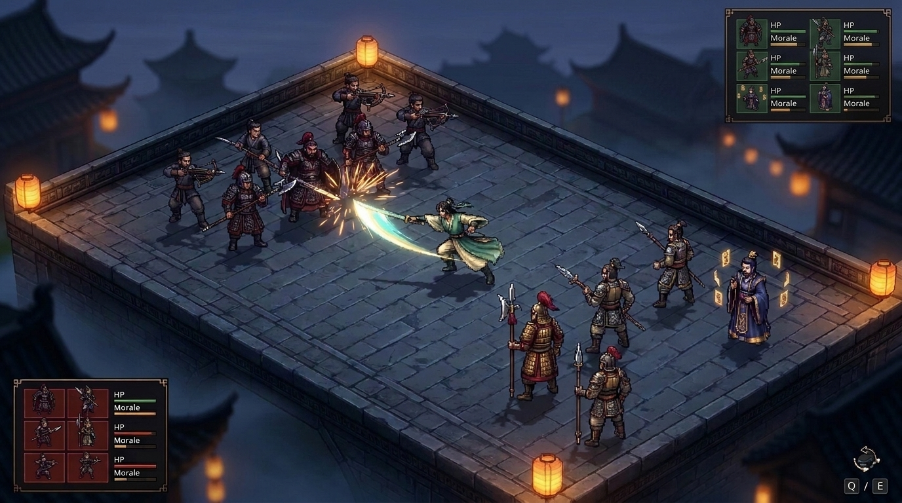

# DOCUMENTO DE ESPECIFICAÇÃO TÉCNICA E GAME DESIGN (GDD) — AEON
**Referências Conceituais:** *Ogre Battle: The March of the Black Queen* (Quest, 1993) & *Final Fantasy Tactics* (Square, 1997)  
**Direção Criativa de Referência:** Yasumi Matsuno, Hiroshi Minagawa, Akihiko Yoshida  
**Decisão Canônica (Projeto Aeon):** Arena de batalha **2.5D Plana Rotacionável (Estilo *Ogre Battle* HD-2D)** — diorama 3D isométrico rotacionável (`Q / E`) com **piso central 100% plano (`y = 0`) e livre de obstáculos ou degraus escaláveis**. Apenas a disposição diagonal 3×2 dos esquadrões, câmera rotacionável, sombras projetadas e animações de ataque/projéteis operam em 2.5D.



---

## 1. VISÃO GERAL E PARADIGMAS DE GAMEPLAY

O projeto combina a macro-exploração estratégica em tempo real com pausa (*Ogre Battle*) a uma arena tática **2.5D plana rotacionável** de alta legibilidade visual e animações dinâmicas de combate.

| Dimensão Sistêmica | Camada Macro: Mapa Estratégico (*Ogre Battle*) | Camada Micro: Arena 2.5D Plana Rotacionável (*Aeon*) |
| :--- | :--- | :--- |
| **Gênero Primário** | Real-Time Strategy RPG (RTS-RPG) / Grand Strategy | Combate Tático de Esquadrões 3×2 (Estilo *Ogre Battle* HD-2D) |
| **Escala de Comando** | **Macro-Gestão (Esquadrões):** O jogador comanda unidades compostas por até 5 entidades em um mapa de guerra contínuo. | **Micro-Tática por Esquadrão (3×2):** Formações fixas frente a frente (Linha de Frente + Retaguarda) com escolha de alvos e ordens táticas. |
| **Arquitetura Espacial** | **2D Plano com Projeção Oblíqua (3/4 Top-Down):** Ilusão de relevo via *Fake Height*, *Y-Sorting* e colisão na base. | **Arena 2.5D Plana (Diorama 3D + Sprites 2D):** Piso central `y = 0` sem obstáculos ou degraus escaláveis; câmera isométrica rotacionável em 4 ângulos (`Q / E`). |
| **Fluxo Temporal** | **Tempo Real com Pausa Tática (RTwP):** Relógio contínuo com ciclo Dia/Noite que afeta diretamente mecânicas e economia. | **Por Turnos / Iniciativa (`agility`):** Turnos determinados por agilidade em `TurnBattleSession.gd` (ou resolução automática em `CombatResolver.gd`). |

---

## 2. ARQUITETURA DE DESIGN GRÁFICO, RENDERIZAÇÃO E DIREÇÃO DE ARTE

### 2.1. Pipeline Visual Híbrido (Macro 2D Oblíquo vs. Micro 2.5D Plana)
*   **Estética Base:** Realista e fundamentada (*Grounded Historical / Dark Fantasy*), utilizando paleta terrosa/atmosférica com iluminação dramática de lanternas, tochas ou neblina, contrastando com efeitos mágicos/táticos pontuais de alta saturação.

#### A. Camada Macro (Mapa Mundi / Mapa de Campanha): Projeção Oblíqua 3/4
*   **Projeção Câmera:** Câmera **Ortográfica Fixa** em projeção oblíqua (*Top-Down 3/4*), exibindo simultaneamente o plano horizontal do solo e a face frontal das elevações, árvores e estruturas.
*   **Técnica de *Fake Height* (Altura Falsa) e *Layered Tilemaps*:**
    *   O mapa opera logicamente sobre uma **grade 2D plana $(X, Y)$**, sem coordenada real de altura ($Z$).
    *   **Footprint Collision (Colisão na Base):** As caixas de colisão restringem-se estritamente à base onde o elemento toca o solo (tronco da árvore, base da montanha, fundação da fortaleza).
    *   **Overhead/Foreground Rendering & Y-Sorting:** Copas de árvores, topos de montanhas e telhados são ordenados dinamicamente pelo eixo `Y`, criando oclusão natural quando um esquadrão marcha por trás de um relevo.
    *   **Exceção de Voo (*Flying Layer Override*):** Esquadrões com locomoção aérea (ex.: *Xian*) sobrevoam obstáculos terrestres em camada superior.

#### B. Camada Micro (Arenas de Batalha): Arquitetura 2.5D Plana (HD-2D / Billboarding)
*   **Projeção Câmera:** Câmera em **Perspectiva Isométrica (ou Ortográfica Isométrica)** sobre um **Diorama 3D Poligonal Rotacionável** em 4 ângulos cardeais ($0^\circ, 90^\circ, 180^\circ, 270^\circ$ via `Q / E`), com ajuste suave de *Pitch* e *Zoom*.
*   **Renderização Híbrida 2.5D em Piso Plano (Cenário 3D + Personagens 2D):**
    *   **Piso Central 100% Plano (`y = 0`) e Livre de Obstáculos:** A superfície de combate é um tabuleiro/pátio/ponte retangular **totalmente plano e desobstruído**. Não há degraus internos, paredes ou obstáculos para os personagens subirem ou descerem. Elementos de ambiência (lanternas nos cantos, muretas externas, canais, pagodes, árvores ou ruínas) ficam exclusivamente **ao redor e abaixo da borda externa** do tabuleiro.
    *   **Entidades em Campo (`Sprite3D` / Cylindrical Billboards):** Os combatentes são *Sprites 2D* em pixel art 32-bit renderizados como *billboards* sobre o plano `y = 0`, rotacionando no eixo `Y` para encarar a câmera enquanto o cenário gira, projetando sombras suaves no piso 3D (`Cast Shadows`).
    *   **Animações de Ataque e Impacto em 2.5D:** Toda a tridimensionalidade tática da luta acontece na **disposição diagonal 3×2** e nas **animações sobre o piso plano**: investidas diagonais de ataque corpo a corpo (*dash* até o alvo e retorno ao slot), arcos de corte em perspectiva, projéteis e talismãs cruzando a arena, recuo ao sofrer dano e sombras acompanhando o movimento.
    *   **Iluminação Dinâmica:** Suporte a luzes quentes de borda (lanternas/tochas), sombra projetada no solo plano e *normal maps* nos *sprites* em `gl_compatibility`.

### 2.2. Especificações de Sprites, Proporção e Animação
*   **Proporções Anatômicas Realistas (Escala Heroica 7,5 a 8 Cabeças):**
    *   Diferente de abordagens *Chibi/SD*, os personagens seguem **proporções humanas realistas** (relação cabeça-corpo de aproximadamente $1:7.5$ a $1:8$), com anatomia verossímil e caimento físico de tecidos e armaduras.
    *   **Compatibilidade com Folhas 4×4 Atuais:** As folhas de animação 4×4 laterais já existentes (`idle`, `walk`, `attack`, `hit/guard`) funcionam diretamente como base em *billboarding* com espelhamento horizontal sobre o piso plano, podendo receber ângulos traseiros/adicionais (`Back-Left`, `Back-Right`) progressivamente para rotações de 180°/270°.
*   **Variabilidade de Gênero e Verossimilhança Histórica:**
    *   Em cenários históricos (Atos I–III), a composição regular reflete a época; combatentes femininas em campo adotam vestimenta marcial verossímil sem armaduras hipersexualizadas, mantendo silhuetas funcionais e coerência histórica.
*   **Identidade Visual por Classe (Silhueta, Postura e Equipamento):**
    *   Legibilidade tática rápida por silhueta, postura de guarda e equipamento (ex.: Youxia com manto jade e *jian*, Alabardeiro Ji com armadura lamelar bronze-dourada, Fangshi com túnica índigo e talismãs).
*   **Estados de Animação Obrigatórios:**
    *   `Idle_Combat`, `Walk/Dash_Tactical`, `Attack_Melee` (antecipação, golpe e retorno), `Attack_Ranged/Cast`, `Hit_Recoil`, `Guard/Parry`, `KO/Downed` e `Victory`.

### 2.3. Arquitetura de UI/UX (Interface e Experiência do Usuário)
*   **Diegese e Feedback Visual:**
    *   *Camada Macro:* Mini-ícones/tokens animados sobre o mapa oblíquo, barras compactas e ciclo Dia/Noite.
    *   *Camada Micro (Arena 2.5D Plana):* Dois painéis compactos nos cantos opostos (estilo *Ogre Battle* — superior direito para esquadrão aliado e inferior esquerdo para esquadrão inimigo) exibindo a grade **3×2** com **HP** e **Moral**, destaque dourado/luminoso no piso sob a unidade ativa e marcador vermelho sob o alvo selecionado, além de indicador discreto de rotação de câmera (`Q / E`).
*   **Combat Forecast (Janela de Previsão):**
    *   Ao passar o cursor ou selecionar um alvo, exibir previsão determinística antes da confirmação: **Dano Estimado (HP)**, **Impacto na Moral**, e **Chance de Acerto / Efeito (%)**.

---

## 3. SISTEMA DE MAPAS, EXPLORAÇÃO E TOPOGRAFIA

### 3.1. Camada Macro (*Ogre Battle*): O Mapa Estratégico Contínuo (2D Oblíquo)
O mapa estratégico opera em grade 2D lógica $(X, Y)$ com nós conectados:
1.  **Bases, Cidades e Fortalezas:** Pontos capturáveis e defensáveis com produção de recursos e regras locais (como controle de água/cerco).
2.  **Locais Ocultos e Noturnos:** Encontros e nós revelados por exploração, horário (noite) ou itens específicos (ex.: *Carta Celeste*).
3.  **Locomoção e Terreno:** Terrenos terrestres, marítimos (`SEA`) e aéreos afetam rotas e velocidade de marcha.

### 3.2. Camada Micro (Arena 2.5D Plana): Dados do Palco de Batalha (`BattleStage25D`)
Como a arena não possui obstáculos ou degraus escaláveis no chão de luta, a estrutura de dados da arena descreve o **palco plano** e o **diorama externo**, substituindo matrizes de altura `elevation_z`:

```json
// Estrutura de Dados de um Palco da Arena 2.5D Plana (BattleStage25D)
{
  "stage_id": "act1_tianxu_bridge_courtyard",
  "floor_plane_y": 0.0,
  "surface_type": "IMPERIAL_STONE",     // IMPERIAL_STONE, WOOD_BRIDGE, MUD, COBBLESTONE, CYBER_GRID
  "is_flat_obstacle_free": true,        // Garantia arquitetural: sem degraus ou obstáculos internos
  "player_3x2_anchors": [ ... ],        // 6 âncoras diagonais (slots 0..2 frente, 3..5 retaguarda)
  "enemy_3x2_anchors": [ ... ],         // 6 âncoras diagonais opostas
  "perimeter_props": ["corner_lanterns", "stone_balustrade", "dusk_canal_backdrop"],
  "lighting_preset": "dusk_lantern_warm",
  "weather": "CLEAR"                    // CLEAR, RAIN, FOG, ASH, DIGITAL_GLITCH
}
```

---

## 4. SISTEMA DE BATALHAS E LÓGICA DE COMBATE

### 4.1. Transição Macro $\rightarrow$ Micro
*   Quando um esquadrão intercepta outro no mapa estratégico, o relógio macro pausa (`is_paused`) e a **Arena 2.5D Plana** correspondente ao bioma/nó atual é instanciada com os dois esquadrões em disposição diagonal **3×2**.

### 4.2. Mecânicas do Combate 3×2 no *Aeon*
*   **Formação 3×2 por Fileira:** Slots `0..2` (Linha de Frente) e `3..5` (Retaguarda). Unidades colossais (`grid_slots = 2`, ex.: *Tarasca*) ocupam a coluna inteira.
*   **Ordem de Turnos e Controle:** Ordenação determinística por `agility`. `TurnBattleSession.gd` permite selecionar ação (`front_action` / `back_action`, **Poupar**, **Defender**) e alvo; `CombatResolver.gd` executa resolução automática determinística.
*   **Dois Vetores de Vitória:**
    1.  **Aniquilação (`HP = 0`):** favorece a linha **Revolucionária** (`doctrine > 0`).
    2.  **Rendição por Moral (`Moral = 0`):** favorece a linha **Pacifista** (`doctrine < 0`), poupa vidas e eleva `popular_support`.
*   **Referências Opcionais de Evolução Futura:** Mecânicas inspiradas em *FFT* (como compatibilidade de elementos/sinais ou *Permadeath* com contagem regressiva) permanecem opcionais e não devem violar os contratos de `SCHEMA_CANON.md`.

---

## 5. ECONOMIA, DOUTRINA, ALINHAMENTO E PROGRESSÃO

*   **Macro (*Ogre Battle*):** Ciclo contínuo Dia/Noite, tributos por nós controlados, alinhamento (`alignment` 0..100), apoio popular (`popular_support` 0..100) e doutrina (`doctrine` -100 Pacifista .. +100 Revolucionária).
*   **Micro (Evolução de Unidades):** Promoções condicionadas por nível mínimo, `alignment`, `doctrine`/carisma e consumo opcional de relíquias (`required_item_id` em `PromotionRules.gd`), além de equipamentos por slot em `EquipmentPanel.gd`.

---

## 6. DIRETRIZES DE IMPLEMENTAÇÃO NO GODOT 4.7.2 (`gl_compatibility`)

### 6.1. Arquitetura de Dados (Data-Driven)
*   Todos os atributos, habilidades, custos, nós e eras residem em `.tres` e `.dtl` sob `res://eras/act_XX/`, nunca *hardcoded* em `.gd`.
*   Scripts `.gd` respeitam o limite máximo de **250 linhas** e se comunicam por `EventBus` / `WorldState` / `EssenceState`.

### 6.2. Renderização e Câmera (Macro 2D vs. Arena 2.5D Plana)
*   **Camada Macro (`OverworldMap.tscn`):** Câmera 2D ortográfica, `YSort`/Fake Height por base de colisão, `SquadToken` animado e `DayNightTint`.
*   **Camada Micro (`BattleArena` 2.5D Plana):**
    *   **Palco 3D Plano (`Node3D`):** Piso único em `y = 0` (`MeshInstance3D` texturizado + borda/diorama externo), garantindo visibilidade total dos 12 slots 3×2 sem oclusão por degraus ou paredes.
    *   **Câmera Orbital (`Camera3D`):** Rotação suave em torno do centro do tabuleiro (`Q / E` em passos de `90°` ou ajuste livre limitado), com *Lerp* sutil para enquadrar atacante e alvo durante golpes.
    *   **Billboarding (`Sprite3D`):** Cada combatente usa `Sprite3D` com `billboard = BILLBOARD_ENABLED` (ou Y-billboard cilíndrico), `texture_filter = TEXTURE_FILTER_NEAREST`, sombra projetada no plano `y = 0` e animação dirigida por código/Tween para avanço diagonal, corte/projétil e retorno ao slot.

### 6.3. Checklist de UX e Polimento ("Game Feel")
*   [x] **Navegação e Interlúdios por Local:** Clique/toque no mapa e fundos dedicados por nó (`LocationRoom.tscn`).
*   [x] **Combate por Turnos 3×2:** Seleção de ação e alvo por unidade (`TurnBattleSession.gd`).
*   [ ] **Prototipagem da Arena 2.5D Plana Rotacionável:** Migrar a apresentação visual de `BattleArena` para palco 3D plano `y = 0` com câmera orbital `Q / E` e `Sprite3D` billboard mantendo 100% da lógica de `CombatResolver` / `TurnBattleSession`.
*   [ ] **Combat Forecast Determinístico:** Exibir dano HP/Moral estimado e chance de acerto antes de confirmar o golpe.
*   [ ] **Hitstop, Screen Shake e Feedback de Impacto:** Pausa curta de impacto (`30ms–60ms`), micro-tremor de câmera e partículas/arcos em 2.5D.
*   [ ] **Áudio Adaptativo e Normal Maps:** Camadas `.ogg` no `AudioDirector.gd` e iluminação com `*_n.png`.
